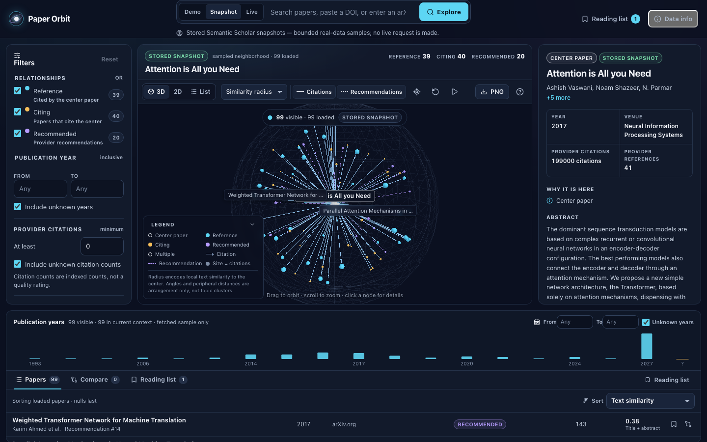

# Paper Orbit

**Explore the research around a paper.**

Paper Orbit is a single-user research-neighborhood explorer built for the
UMass Amherst COMPSCI 571 project. Start from a known paper, then inspect a
bounded sample of its references, citing papers, and provider recommendations
in a coordinated 3D sphere, SVG radial map, sortable list,
publication-year histogram, details panel, comparison view, and reading list.



## Public deployment

- **Live site:** [paper-orbit-live.vercel.app](https://paper-orbit-live.vercel.app/)
- **Static mirror:** [simardeep27.github.io/paper-orbit](https://simardeep27.github.io/paper-orbit/)

The Vercel deployment runs the full Next.js app. Its live mode uses OpenAlex's
key-free public API, so live search, resolution, and neighborhoods work without
asking a reader for credentials. The GitHub Pages mirror uses the same OpenAlex
calls from the browser for live mode and keeps stored snapshots and the
synthetic demo offline.

## What works

- Search by title or keyword, and resolve DOI / arXiv identifiers.
- Load a bounded ego-neighborhood: up to 40 references, 40 citing papers, and
  20 recommendations, with branch-level provenance and partial-failure states.
- Spherical Three.js view with orbit/zoom, selecting, locating, camera reset,
  optional auto-rotation, PNG export, and an automatic 2D fallback if WebGL
  initialization or context fails.
- A real SVG radial view, a first-class HTML list, a linked year histogram, and
  synchronized filters/selection/counts.
- Paper details, two-paper comparison, explicit recenter, bounded history, URL
  restoration, and stale-request protection.
- Local `localStorage` reading list with Markdown/JSON export and safe filenames.
- Three clearly separated data modes: live OpenAlex, stored Semantic Scholar
  snapshots, and a visibly fictional synthetic demo.
- Responsive layout, keyboard-only flows, reduced-motion handling, and automated
  unit/component/end-to-end checks.

## Requirements

- Node.js **24.10.0** (recorded in `.nvmrc`; `package.json` requires `>=24`)
- npm
- Internet access only for the optional live mode

## Run locally

```bash
cd /Users/ssethi/Documents/build/paper-orbit
npm ci
```

Live mode uses OpenAlex and needs no key:

```bash
LIVE_PROVIDER=openalex npm run dev
# open http://localhost:3000
```

To use the optional server-side Semantic Scholar provider instead, copy
`.env.example` to `.env.local`, set `LIVE_PROVIDER=semantic-scholar` and
`SEMANTIC_SCHOLAR_API_KEY`, then restart. Never use a `NEXT_PUBLIC_` prefix for
the key. The public Vercel deployment sets `LIVE_PROVIDER=openalex`.

Start the app:

```bash
npm run dev
# open http://localhost:3000
```

Production check:

```bash
npm run build
npm run start
```

The bundled snapshot and synthetic demo modes need neither network access nor an
API key.

## Data modes

| Mode | Source | Network | Purpose |
|---|---|---|---|
| **Live** | OpenAlex public API (or keyed Semantic Scholar when configured) | Yes | Current provider data; key-free on the public deployment; bounded sample |
| **Stored snapshot** | Three normalized neighborhoods in `data/snapshots/` | No | Reliable review/demo of real Semantic Scholar metadata |
| **Synthetic demo** | 42 fictional papers and 3 neighborhoods in `data/demo/` | No | Deterministic interaction, partial-branch, and unavailable-recenter tests |

The mode is visible in the header, search results, neighborhood status chip,
details panel, provenance dialog, and exports. Synthetic records are never mixed
with live or snapshot records.

Stored snapshot centers:

- [Attention is All you Need](https://www.semanticscholar.org/paper/204e3073870fae3d05bcbc2f6a8e263d9b72e776) — 100 loaded nodes
- [A Deep Reinforced Model for Abstractive Summarization](https://www.semanticscholar.org/paper/032274e57f7d8b456bd255fe76b909b2c1d7458e) — 98 loaded nodes
- [A Learning Algorithm for Continually Running Fully Recurrent Neural Networks](https://www.semanticscholar.org/paper/ce9a21b93ba29d4145a8ef6bf401e77f261848de) — 60 loaded nodes, with a preserved failed references branch

The first two are linked by an observed reference, and the second links to the
third, so offline recenter and history can be demonstrated across real centers.

## Scripts

```bash
npm run dev             # Next.js development server
npm run build           # production build
npm run start           # production server
npm run lint            # ESLint
npm run typecheck       # TypeScript
npm test                # Vitest unit/component tests
npm run test:e2e        # Playwright (builds and starts production on :3100)
npm run demo:synthetic  # regenerate the fictional demo fixtures
npm run demo:fetch -- --seed "Attention Is All You Need"
                        # opt-in live acquisition into data/snapshots/
```

`demo:fetch` supports repeatable `--seed`, `--out`, `--pool recent|all-cs`, and
`--dry-run`. Live acquisition uses the same adapter as the app and requires
`ENABLE_LIVE_API=true` and a server-side key in the environment:

```bash
SEMANTIC_SCHOLAR_API_KEY=... ENABLE_LIVE_API=true \
  npm run demo:fetch -- --seed "Attention Is All You Need"
```

Do not put the key in a command that will be committed to shell history or a
file. The app never runs `demo:fetch` during build, tests, or normal startup.

## Configuration

See `.env.example`. Values are server-only:

- `LIVE_PROVIDER` — `openalex` for the key-free public deployment, or
  `semantic-scholar` for the optional keyed provider. Defaults to
  `semantic-scholar` for local/backward-compatible server runs.
- `SEMANTIC_SCHOLAR_API_KEY` — only needed when
  `LIVE_PROVIDER=semantic-scholar`; leave blank otherwise.
- `UPSTREAM_MIN_INTERVAL_MS` — upstream scheduler interval, default 1100 ms.
- `UPSTREAM_TIMEOUT_MS` — per-request timeout, default 8000 ms.
- `ENABLE_LIVE_API` — set `false` to force offline/snapshot-only behavior.
- `RECOMMENDATION_POOL` — `all-cs` (default) or `recent`.

No credential is bundled, exported, put in a URL, or returned in an API error.
Only normalized provider metadata is stored; full text and request headers are
not stored.

## Architecture

```text
Browser
  Search / filters / list / details / comparison / reading list
                 │
        canonical Zustand exploration state
                 │
    ┌────────────┼─────────────┐
  Three.js     SVG radial    HTML list + histogram
                 │
        same-origin /api routes
                 │
      Zod validation → LRU cache → rate-limited adapter
                 │
      OpenAlex live API  |  Semantic Scholar snapshots  |  synthetic demo
```

Key directories:

- `app/` — App Router pages and four server routes.
- `components/` — search, explorer, Three.js, SVG, histogram, list, details,
  comparison, provenance, reading list.
- `lib/providers/` — OpenAlex live adapter, optional Semantic Scholar adapter,
  stored snapshot provider, synthetic demo provider, shared catalog search.
- `lib/graph/` — normalization, graph invariants, TF-IDF, layout, selectors,
  export.
- `lib/state/` — Zustand store, URL state, reading-list persistence.
- `tests/unit/`, `tests/e2e/` — deterministic tests.
- `data/demo/`, `data/snapshots/` — versioned local data.
- `qa/` — reproducible QA scripts, screenshots, logs, and measured results.
- `docs/` — data sources, design rationale, course drafts, evaluation plan,
  demo script, and QA report.

## Verification snapshot

Measured on October 28, 2026 on the local review machine:

- `npm run lint` — pass
- `npm run typecheck` — pass
- `npm test` — 13 files, 100 tests pass
- `npm run test:e2e` — 16 Playwright tests pass
- `npm run build` — pass
- Desktop, mobile, keyboard-only, reduced-motion, WebGL fallback, filter
  synchronization, comparison, unavailability, and console checks — pass
- Live OpenAlex search, DOI/arXiv resolution, and a 91-node live neighborhood
  were verified on the Vercel production URL on November 24, 2026. The earlier
  keyed Semantic Scholar live checks are in `qa/live-verification.json`.
- 100-node stored-snapshot 3D drag: median 60.0 FPS in headless Chromium at
  1440×900; filter-to-DOM update median 16.1 ms. See `qa/perf.json`.

Exact commands, test evidence, screenshots, and limitations are in
[`docs/QA_REPORT.md`](docs/QA_REPORT.md).

## Data provenance and license

Live metadata comes from [OpenAlex](https://openalex.org/), whose data is
available under CC0. Stored snapshots come from the
[Semantic Scholar API](https://www.semanticscholar.org/?utm_source=api). The
[Semantic Scholar API license](https://api.semanticscholar.org/license/) limits
use to internal research/education and requires public displays of data to point
back to Semantic Scholar with `utm_source=api` and include the Semantic Scholar
name and logo. This local course prototype includes the name and link in its provenance
panel, footer, and about page; it does **not** bundle an official logo. Review the
license and add the permitted official logo/asset before any public deployment.
Do not publicly redistribute the snapshots or abstracts without confirming the
provider terms. Full text is never fetched or stored.

The synthetic demo is hand-authored and fictional. It is labeled everywhere and
must not be cited.

## Known limitations

- Neighborhoods are bounded samples, not complete citation graphs.
- Live OpenAlex access is subject to public rate limits and transient upstream
  failures. The optional Semantic Scholar provider has a much tighter
  credentialed limit. The app preserves partial data rather than converting a
  failed branch into an empty one.
- Live neighbor requests retrieve title and metadata fields, so local text
  similarity is title-only; some stored neighbors also lack abstracts.
- The third stored snapshot intentionally preserves a failed references branch
  from acquisition; it is not “zero references.”
- The app stores normalized metadata and abstracts only; no PDFs or full text.
- The 3D export is a PNG of the active canvas, not an editable scene.
- Performance numbers are local/headless observations, not a laboratory
  benchmark. At more than 60 nodes the renderer reduces geometry detail,
  disables antialiasing, uses Lambert materials, and caps pixel ratio to 1.5
  while retaining every node.
- No formal user study has been run; the evaluation plan is blank and future.

## Documentation

- [`docs/DATA_SOURCES.md`](docs/DATA_SOURCES.md)
- [`docs/DESIGN_RATIONALE.md`](docs/DESIGN_RATIONALE.md)
- [`docs/DELIVERABLE_1_DRAFT.md`](docs/DELIVERABLE_1_DRAFT.md)
- [`docs/DELIVERABLE_2_DRAFT.md`](docs/DELIVERABLE_2_DRAFT.md)
- [`docs/EVALUATION_PLAN.md`](docs/EVALUATION_PLAN.md)
- [`docs/DEMO_SCRIPT.md`](docs/DEMO_SCRIPT.md)
- [`docs/QA_REPORT.md`](docs/QA_REPORT.md)
