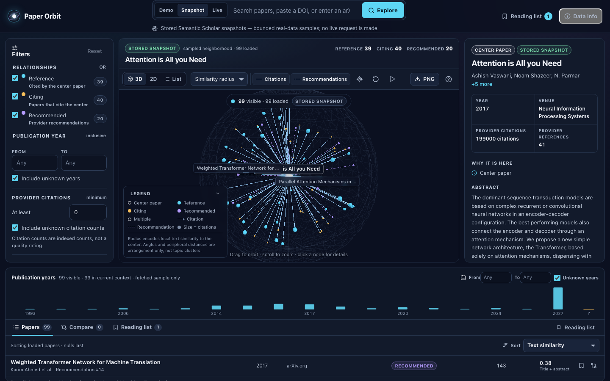

# Deliverable 2 draft — Prototype and design rationale

> **Draft status.** Working Markdown for a future two-page text + up-to-three-page
> figure PDF. It describes the implemented prototype and actual screenshots; it
> is not a claim of a completed user evaluation.

## 1. Prototype summary

Paper Orbit is a Next.js/React research-neighborhood explorer. A user starts from
a title, DOI, or arXiv ID and loads a bounded neighborhood around the selected
paper: up to 40 references, 40 citing papers, and 20 Semantic Scholar
recommendations. The same canonical state drives:

- a Three.js spherical view,
- a real SVG radial view,
- an accessible sortable list,
- a linked year histogram,
- a details panel and two-paper comparison,
- a local reading list and exports.

Three modes are visibly separated: **live provider**, **stored real snapshot**,
and **synthetic demo**. The synthetic catalog is fictional and always labelled;
it is never a silent fallback. The stored snapshots make a real-data
demonstration reproducible without network access.

## 2. Key design decisions and task justification

### 2.1 Spherical ego-neighborhood

The sphere is an overview of a bounded sample, not a map of a field. The center
is fixed at the origin and enlarged with a halo. Neighbors are placed by a
deterministic hash direction.

- **Similarity-radius layout:** radius decreases as local text similarity to the
  center increases. This makes the local scoring visible without claiming that
  angular position means anything.
- **Even-shell layout:** all neighbors share a radius when abstracts are missing
  or the user wants only relational structure.
- **Unknown similarity:** a distinct outer shell, never a fabricated middle
  value.

Angles and peripheral-to-peripheral distances are explicitly arrangement-only.
The list/details panel, not visual proximity, is the precise comparison tool.

### 2.2 Separate channels for separate relationships

| Relationship | Visual | Text/action |
|---|---|---|
| Reference | Cyan node; solid arrow center → reference | “Reference” badge; reference filter |
| Citing | Amber node; solid arrow citing paper → center | “Citing” badge; citing filter |
| Recommended | Violet node; dashed association, no arrow | “Recommended” badge + rank; recommendation filter |
| Multiple | White outline; merged memberships | Multiple text badges; one list row |
| Citation count | Log-scaled node size | Numeric count; unknown glyph distinct from zero |
| Text similarity | Radius (when enabled), numeric list value | Coverage label: title+abstract, title-only, unavailable |

Citations are never inferred from shared authors, titles, years, or
recommendation membership. Recommendation links are a separate data structure and
never become citation edges. Citation arrows preserve direction.

### 2.3 Coordinated views reduce occlusion and perspective risk

3D perspective and occlusion are useful for a gestalt but poor for precise
reading. The design therefore makes the 2D SVG and HTML list first-class:

- The 2D view uses the same nodes, edges, filters, selection, radius semantics,
  and deterministic angles. It is a true SVG renderer, not a canvas screenshot.
- The list exposes title, year/unknown, first authors, venue, membership badges,
  citation count/unknown, text similarity/coverage, save, and compare.
- The histogram excludes the center, counts unknown years separately, and keeps
  its context population while highlighting the active year interval.
- Selecting a list row highlights the same graph node; selecting a node updates
  details. Hover remains separate from persistent selection.

### 2.4 Filtering model

Relationship checkboxes are OR. Year, minimum citations, minimum similarity, and
local text filters are AND. Unknown years, unknown citation counts, and
unavailable similarity have explicit include/exclude controls rather than being
coerced to zero. The center remains visible and is excluded from visible counts.
Edges survive only when both endpoints are visible. Graph, list, counts, and
histogram share one derived selector.

Filters do not recompute scores, relayout nodes, or issue API requests. Reset
filters leaves camera/history/reading list intact. Reset camera leaves filters
intact.

### 2.5 Explicit recenter transaction

Recentering is separate from selection. The current graph stays visible during
loading. Each request increments a generation token; only the latest response may
commit. On success, the new center, filters, history, URL, and selection commit
atomically. On failure, the old graph and history remain and the user gets a
recoverable error. Back/forward restore cached state and filters.

For offline modes, a catalog-only paper can be inspected and saved, but recenter
explains that no stored neighborhood exists. The app never fabricates a
re-centered graph by reversing edges or reusing an old sample.

### 2.6 Provenance as part of the visualization

The Data info dialog records provider, mode, retrieval timestamp, pool, requested
limits, branch status, received entries, distinct papers, skipped records, next
offsets, missing years/counts/abstracts, and the similarity algorithm/version.
A partial branch is shown as failed/unavailable, not as an empty citation record.

This is essential because Semantic Scholar neighborhoods are bounded samples,
citation indexing is uneven, and most neighbor records in the bundled snapshots
lack abstracts. A polished graph must not imply completeness.

## 3. Visual system

- Background `#0B1020`; panels `#121A2B`; raised panels `#19243A`.
- Text `#F3F5FA`; muted `#B0BCD0`; borders `#30405B`.
- Reference cyan `#5DD6F4`; citing amber `#F6BE5A`; recommendation violet
  `#B69CFF`.
- System sans-serif stack; no network font dependency.
- 4/8 px spacing rhythm, 10–14 px radii, subtle borders/shadows.
- Restrained star/grid backdrop; decorative marks do not resemble paper nodes.
- Legends and labels are always textual, not color-only.

Measured contrast ratios on the dark surfaces were all above WCAG AA for the
primary text, muted text, and relationship accent text (7.6:1 to 17.4:1 in the
checked pairs). The 3D node colors are reinforced by membership badges and the
list.

## 4. Accessibility and resilience

- Search, selection, filters, comparison, save, recenter, and back navigation are
  available through HTML controls and were exercised in keyboard-only Playwright
  tests.
- The canvas has a role/label/instructions and points to the list equivalent.
- Focus is visible; drawers/dialogs close with Escape and restore focus; year
  inputs duplicate brushing.
- Reduced motion disables auto-rotation and uses immediate camera transitions.
- A forced WebGL failure automatically switches to 2D, disables 3D, and keeps
  filtering/list/recenter usable.
- At 390×844 there is no horizontal page overflow and the default view is 2D.
- At an effective 720×450 viewport (a 200% zoom approximation) there was no
  horizontal overflow; the intended reading mode at that size is 2D/list.

## 5. Performance design

The required sample can contain 101 nodes. The renderer is bounded and uses
deterministic sphere placement, capped pixel ratio, limited labels, and immediate
cleanup on unmount. For more than 60 nodes it:

- lowers sphere tessellation,
- disables antialiasing,
- uses lighter Lambert materials,
- caps pixel ratio at 1.5.

It retains every node and all analytical functions. A local headless Chromium
measurement at 1440×900 produced a median 60.0 FPS while dragging the 100-node
stored snapshot and 59.3 FPS on the 21-node synthetic demo. Filter-to-coordinated
DOM update median was 16.1 ms in-page. These are local observations, not a
laboratory benchmark; the renderer uses software WebGL in this environment.

## 6. Actual screenshots

| Figure | Path | What it shows |
|---|---|---|
| 1 | `../qa/screenshots/snapshot-3d.png` | Real stored snapshot, 3D sphere, relationship legend, branch counts |
| 2 | `../qa/screenshots/desktop-2d.png` | SVG radial fallback with the same state |
| 3 | `../qa/screenshots/desktop-list.png` | List view with metadata, badges, similarity, save/compare |
| 4 | `../qa/screenshots/compare-panel.png` | Two-paper comparison |
| 5 | `../qa/screenshots/unavailable-recenter.png` | Honest unavailable recenter with preserved graph |
| 6 | `../qa/screenshots/webgl-fallback.png` | Forced WebGL failure and usable 2D fallback |
| 7 | `../qa/screenshots/explorer-mobile.png` | 390 px mobile layout |

## 7. Limitations and design tradeoffs

- The 3D sphere is intentionally not a precise comparison surface; precise values
  live in the list/details.
- 3D perspective can create occlusion; selection, labels, 2D, and list mitigate
  it but do not eliminate it.
- Citation counts are provider metadata, not quality. Log size and explicit
  wording reduce overread but cannot remove citation bias.
- Many abstracts are missing; title-only similarity can miss conceptual matches.
  The interface labels this instead of hiding it.
- Recommendations are candidates with an ordering, not a similarity magnitude.
- The stored snapshots are bounded samples and one preserves a failed branch.
- Provider rate limits can produce partial live neighborhoods; the UI keeps the
  partial state explicit and the snapshot mode is the reliable demo path.
- No formal user study has been completed, so no claim is made that 3D is better
  than 2D/list for any task.
