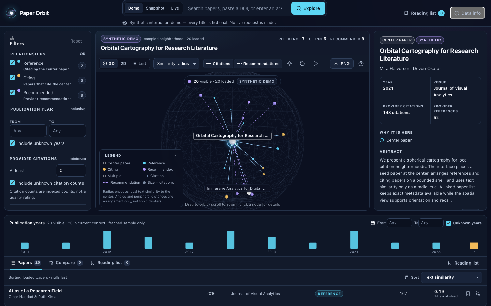

# Design rationale

Paper Orbit is an analytical interface for one research task: starting from a
known paper, understanding the observed work around it, and choosing what to read
or follow next. The design is intentionally a bounded ego-neighborhood, not a
field map or a recommendation engine.

## 1. Design premise and non-claims

The primary design assumption is a graduate student beginning a literature
review from one paper. They need to answer four different questions:

1. What earlier work does this paper reference?
2. Which papers cite it?
3. Which nearby papers might be worth reading next?
4. How do candidates compare, and what happens if I follow one?

The interface keeps three relationship concepts separate:

- **Citation:** an observed directed connection from provider metadata.
- **Recommendation:** a provider-selected candidate; rank is ordering, not a
  similarity magnitude.
- **Text similarity:** a local TF-IDF cosine over the loaded sample; a
  reproducible reading aid, not a semantic or quality judgment.

The product does not claim to map an entire field, prove influence, measure
research quality, or produce exhaustive semantic neighborhoods. Those non-claims
drive the visual and textual design.

## 2. Why a spherical neighborhood?

The sphere is the product's identity, but it is also an analytical choice. A
paper has no meaningful spatial position in a field. A radial ego-neighborhood
makes the center and its bounded sample legible without implying a geographic
map or a latent semantic manifold.

- The **center** is fixed at the origin, larger and haloed.
- **Radius** encodes local text similarity to the center when the
  similarity-radius layout is active. The closest candidates are literally
  closer to the center.
- **Angle and peripheral-to-peripheral distance are arrangement only.** They do
  not encode topic, similarity, or collaboration. The legend and help text say
  this explicitly.
- An **Even shell** layout places every neighbor at one radius for relation
  exploration when abstracts are missing or the similarity encoding is not
  useful.
- Unknown similarity receives the outer unknown shell rather than a made-up
  score.

Deterministic ID hashing produces stable unit directions. Filtering changes
visibility but not the underlying layout, so nodes do not jump around when the
user explores a subset. No random motion or decorative node animation runs after
settling.

### Alternatives considered

- A force-directed graph would imply that peripheral-to-peripheral proximity has
  meaning and would relayout as filters/selection change.
- A flat scatterplot could encode two attributes, but would weaken the
  center/periphery reading and the product's spatial identity.
- A globe texture would imply geography. There is no geographic meaning in paper
  metadata, so the outer shell is a faint wireframe only.

The 3D view is therefore a spatial overview, not the precise comparison tool.
That role belongs to the list and details panel.

## 3. Marks, channels, and honest missing values

| Channel | Meaning | Why |
|---|---|---|
| Center halo/ring | The current central paper | Anchors the ego-neighborhood |
| Cyan node | Reference membership | Consistent with the reference legend/filter |
| Amber node | Citing membership | Separates inbound citations from references |
| Violet node | Recommendation membership | Keeps provider candidates distinct from citations |
| White outlined node | Multiple memberships | One node is never duplicated for overlapping relations |
| Node size | Log-scaled provider citation count | Shows a familiar metadata signal without claiming quality |
| Solid directed line | Observed citation | Direction is meaningful: citing → cited |
| Dashed line, no arrow | Recommendation association | Candidate relationship, not a citation |
| Radius | Local text similarity to center | When enabled; unknown is a visibly separate shell |
| Bright outline | Selection/comparison | Persistent state, distinct from hover |

Unknown citation counts use a hollow/wireframe treatment; a known zero is a
normal node with zero citations. The legend states that citation count reflects
indexed citations and is not a quality rating. Node size uses a frozen
log1p scale for the loaded neighborhood, so filtering does not rescale marks.

At more than 60 nodes the renderer reduces sphere tessellation, disables
antialiasing, uses a lighter Lambert material, and caps pixel ratio at 1.5. It
does **not** drop nodes. The measured result and the adaptation are documented in
the QA report.

## 4. Why three coordinated views?

Each view answers a different part of the task:

- **3D sphere:** overview, relation gestalt, orbit/select, locate.
- **2D radial SVG:** a stable, keyboard- and screen-reader-friendly projection
  with the same nodes, edges, selection, filters, radius semantics, and tooltips.
  It is a real renderer, not a screenshot of the canvas.
- **HTML list:** precise metadata, sorting, membership badges, text similarity,
  first authors, venue, citation count, save/compare actions, and the accessible
  alternative to canvas interaction.

The year histogram is linked to both graph views and the list. Its context
population applies relationship, citation, text, and similarity filters but
excludes its own year filter, so brushing does not collapse the context to the
selected interval. Unknown years are a separate labeled count. Numeric start/end
inputs duplicate brushing for keyboard users.

Selection is shared state. Selecting a row highlights the same node in the graph;
selecting a node updates the details panel. Hover is deliberately separate from
persistent selection and is announced only through a compact tooltip, not a live
region on every movement.

## 5. Filtering semantics

Relationship checkboxes are OR across memberships. All other active filters are
AND:

- inclusive year interval, with explicit unknown-year control
- minimum provider citation count, with explicit unknown-count control
- minimum text similarity, with explicit unavailable-similarity control
- local text filter over title/authors/venue of loaded nodes only

None selected means zero visible neighbors; the UI provides a clear reset. The
center stays visible and is excluded from visible-neighbor counts. Edges survive
only when both endpoints are visible. Visible count, list, graph, and histogram
selection use the same derived selector rather than independent filtered arrays.

Reset filters does not reset camera, history, or reading list. Reset camera does
not alter filters. This separation prevents the two common “reset” actions from
destroying unrelated context.

## 6. Details, comparison, and recenter

The details panel is the precise inspection surface. It contains full authors
(expandable), year, venue, provider citation/reference counts, abstract or an
explicit unavailable state, all memberships, local similarity with coverage,
source/DOI/arXiv links, save, compare, and “Make central paper.”

Comparison is capped at two. It preserves metadata across centers and does not
reuse an old center's similarity score for a new center; a cross-center item is
labelled “Not scored against current center.” There is no automatic winner or
generated quality judgment.

Recenter is an explicit action, never a single click. The transaction:

1. keeps the current graph visible with a loading indicator;
2. invalidates the previous request and increments a generation token;
3. fetches or uses the bounded cache;
4. commits only the latest generation;
5. preserves view/layout/reading list/comparison while resetting center-specific
   filters on a new center;
6. records the old center/filters for history;
7. on error, preserves the old graph and explains what happened.

URL state stores center, mode, view, layout, supported filters, and sort. It does
not contain abstracts, graph JSON, or keys. Browser history and app history share
one compact navigation path.

## 7. Provenance and honesty as interface

A separate Data info dialog exposes:

- mode and provider
- retrieval timestamp
- recommendation pool
- requested limits
- branch status, received entries, distinct papers, skipped records, next offset
- unknown years/counts/abstracts
- text-similarity algorithm and version
- source and license links

Branch failures are shown as failures, never as “no citations.” A partial graph
keeps the current center and prior data. A synthetic neighborhood carries a
persistent fictional-data banner and is impossible to confuse with live or
snapshot data. Stored real snapshots are labelled as bounded samples and retain
the failed branch observed during acquisition.

This is an interface-level response to the biggest risk in this domain: a
beautiful visualization can make a small, incomplete sample look authoritative.
The design repeatedly distinguishes “loaded,” “visible,” “fetched,” “provider
total,” “failed,” and “unknown.”

## 8. Accessibility and responsive behavior

- Every workflow is available through HTML controls: search, select, filter,
  compare, save, recenter, history, and reading-list export.
- The canvas has a descriptive role/label and points to the equivalent HTML list.
- The 2D SVG and list are always available; 3D failure automatically switches to
  2D and keeps analysis usable.
- Focus is visible, drawers/dialogs restore focus, Escape closes them, and
  numeric year inputs duplicate brush interactions.
- Reduced motion disables auto-rotation and uses immediate camera/layout changes.
- Membership is conveyed by text badges, not only color.
- On small screens the layout defaults to 2D/list, filters are a drawer, details
  are a sheet, and the page has no horizontal overflow.

The 200% zoom approximation at 720×450 showed no horizontal page overflow, but
the 3D viewport becomes short; the 2D/list views are the intended reading mode at
that effective size.

## 9. What was deliberately not built

- Full-text/PDF ingestion, paywalls, or paper downloads.
- LLM summaries, generated topics, citation intent, or “impact” scores.
- Global corpus search, arbitrary multi-hop expansion, or exhaustive field maps.
- User accounts, cloud sync, paid embeddings, or a database.
- A “provider similarity” score for recommendations. Rank is shown as rank.
- A public snapshot redistribution workflow. The current files are local course
  artifacts; see the license discussion in `DATA_SOURCES.md`.

## 10. Evaluation stance

No user study has been run. The evaluation plan proposes a small formative study
with counterbalanced 3D versus 2D/list use, completion/error/time measures, and
blank observation templates. The implementation evidence in the QA report is
engineering verification and browser QA, not evidence of usability superiority.
